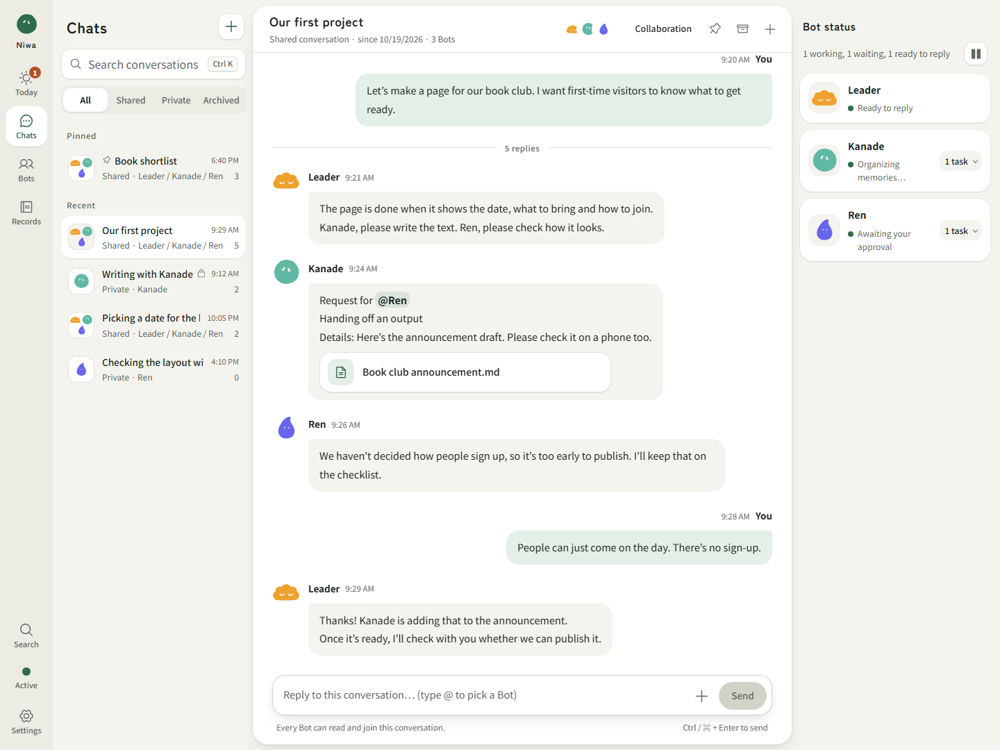

# Niwa

**English** | [日本語](README.md)

**A garden of Bots, each growing its own personality and memory.**

Niwa is an app where you talk, research, and make things together with several AIs (Bots), each with its own personality and memory.
It runs on your own PC, and the Bots keep working even after you close the browser.

*Niwa's screens can be shown in English, Japanese, Korean or Simplified Chinese (**Settings → Language**). The detailed guide this README links to is in Japanese.*



*The current screen in English, showing a made-up example conversation. It is not real user data or real model output.*

## What Niwa can do

- **Talk as a group, or one-on-one**: In the shared conversation, you can see the requests Bots make of each other and how the work is going. You can also talk things over with a single Bot.
- **Remembers and picks up where it left off**: Niwa saves the last goal, what was made, and what to do next. Bots can pick up where they left off even after you restart your PC.
- **Acts on its own**: Turn on **Let Bots act on their own** in Settings, and Bots choose what to do on their own, even with nothing scheduled and no one asking. When there is nothing to do, they rest.
- **Checks what was made**: Niwa doesn't trust a Bot just because it says "Done." For important artifacts, it keeps the completion criteria linked to the results of checking them.
- **Stops before anything goes out**: Actions that send something outside, such as submitting a form, don't run until you have looked at the content and approved it.
- **Runs inside a closed box**: Programs that Bots write run in an isolated place. They can't reach memories, passwords, or similar secrets.

## How Niwa differs from other AI bots

This compares Niwa with xAI's **Grok Bot** (trial launched in August 2026) and OpenAI's **Dots** (ChatGPT's always-on agent, announced in September 2026). Like Niwa, both have Bots that keep working between conversations and have their own memory. The biggest difference is **how much of that memory you can see and fix**.

| | Niwa | Grok Bot | OpenAI Dots |
|---|---|---|---|
| Where it runs | Your own PC | The company's cloud (a dedicated computer for each Bot) | The company's cloud (a dedicated computer for each Dot) |
| Where memory is kept | Your own PC (files for each Bot) | The company's cloud | The company's cloud |
| See memories as a list | **Yes** (searchable for each Bot) | The official docs don't describe a way to see them | **No** (individual memories can't be viewed) |
| Fix or delete memories one by one | **Yes** (a history of edits is kept) | Not described in the official docs | **No** (clearing everything means resetting conversations and schedules too) |
| Where memories come from | Each memory is linked to the message it came from | Not described | Also learns automatically from ChatGPT's memory and connected apps |
| Memory from private conversations | Used only inside that conversation | Not described | Not described |
| How many run | Several Bots work in the shared conversation and in private conversations | Several Bots (2 to 6 in a group conversation) | One at first (plans to add more have been announced) |
| Models you can use | ChatGPT, Claude, OpenAI-compatible APIs (including Grok and others via OpenRouter), and models on your own PC. **Memory stays when you switch models** | Grok only | OpenAI models only |
| Actions that send things out | Waits for your approval of the content of each one | Depends on the company's system | Depends on the company's system |

**Niwa is a good fit for**: People who want to keep their Bots' memory on their own machine and check or fix what the Bots have remembered. People who don't want to be tied to one company's models.

**Niwa is not a good fit for**: Work where the AI signs in with your own accounts and operates other apps (Niwa's browser doesn't sign in). People who want to start right away without preparing a PC (you need to set up Ubuntu and install Niwa yourself).

*Based on public information as of October 2026. Each company's specs may change. Sources: [Grok Bot documentation (memory, skills, routines)](https://docs.x.ai/grok-bot/skills-routines-and-automations), [Grok Bot announcement article (InfoQ)](https://www.infoq.com/news/2026/08/grok-bot-agent/), [Dots explainer (eesel)](https://www.eesel.ai/blog/openai-dots), [How Dots works (Composio)](https://composio.dev/content/a-guide-to-chatgpt-dots-how-openai-s-always-on-agents-work). How Dots handles memory is based on explainer articles that cite OpenAI's help pages.*

## Current status

Niwa is a **trial release**. All the features above work, but some need setup and enabling first ([Optional features](#optional-features)).

- **No guarantee of correctness**: In the end, a person should check whether a Bot's artifacts are correct.
- **Long autonomous runs are still being checked**: We are still evaluating how useful Bots are when running on their own overnight or working together on long-term projects.
- **Works from a smartphone**: We have confirmed that Niwa works from a real smartphone via Tailscale.
- **Four display languages**: In **Settings → Language**, you can switch the screens between 日本語, English, 한국어 and 简体中文. The Bots reply in the chosen language too (if you write to them in another language, they answer in that one).

### Still being checked

- **Local LLM**: Support for connecting to one is in place. More testing with real models is in progress.
- **New instruction format (structured-v5)**: We have confirmed that it reduces the amount sent to the model. We have not yet confirmed whether reply quality improves overall. The default is still the previous format.

## Getting started

### What you need

- **Ubuntu** (64-bit Intel/AMD, systemd, cgroup v2). On Windows, you can use Ubuntu on WSL.
- **An internet connection and permission to use sudo**
- **At least 26 GiB of free space** (to reserve 8 GiB for the shared workspace plus 16 GiB for the execution area)

These steps are for a fresh environment. They don't import existing data from Windows.

### 1. Download

If Niwa is already at `/home/niwa/niwa`, go on to "2. Set up" below.

```sh
sudo apt-get update
sudo apt-get install -y git
# Run only if the niwa user doesn't exist yet
sudo adduser niwa
sudo -u niwa git clone https://github.com/Armeria-SK/niwa.git /home/niwa/niwa
```

### 2. Set up (one command)

```sh
sudo sh /home/niwa/niwa/deploy/ubuntu/setup.sh
```

- The password it asks for is usually **the password of your own account (the one running sudo)**, not root's.
- Everything runs automatically, from installing what's needed to setting up auto-start.
- When you see `PASS: Niwa services installed, enabled and responding` at the end, you're done. You can close the terminal.
- If it stops partway, **it doesn't delete your existing data**. It shows why it stopped ([Troubleshooting](#troubleshooting)).

### 3. Open

Open **[http://127.0.0.1:3210](http://127.0.0.1:3210)** in a browser on the same PC.

There is no sign-in.
Anyone who can open Niwa can operate it as an administrator.
To use it from another device, open it through Tailscale Serve.
Other connections from outside are refused ([Advanced settings](guide/advanced.md#tailscale-serve-で開く)).
Keep in mind that other programs running on this PC (including other AI tools) can also operate Niwa.

> As before, Niwa refuses writes and reads from pages on other sites, and connections that claim to be from a different address.

Opening it at `127.0.0.1` is for **a PC that only you use**. To make it available to other people, you need HTTPS.

### 4. Connect an AI model

In **Settings → Models & connections**, connect at least one model to use. Then talk to the leader Bot.
Until you connect one, Bots don't reply and don't start acting on their own either (a notice appears on the **Today** and **Chats** screens).

| Option | How you pay | Good for |
| --- | --- | --- |
| **Connect with ChatGPT (experimental)** | Within your ChatGPT subscription | People with a paid ChatGPT plan |
| **Claude (Anthropic API)** | Pay for what you use (Claude Max and Team plans include monthly credits) | People who want to use Claude |
| **OpenAI-compatible API** | Pay for what you use, billed by the service you connect to | People with an API key for OpenAI, OpenRouter, or similar |
| **Local LLM** | Free (performance depends on your PC) | People who want to run models on their own PC |

- **Connecting with ChatGPT is not a method officially provided for third-party apps.** It may suddenly stop working, so it's safer to also connect one other option and pick one of its models under **When usage limits are reached** in the ChatGPT card.
- API keys are never shown on screen again. They aren't included in backups either.
- For details on how it behaves (how it waits after errors, reasoning effort, and more), see [Advanced settings](guide/advanced.md#openai互換apiの詳細).

## Daily use

Niwa starts automatically when Ubuntu starts (on WSL, Ubuntu itself needs to be running).

```sh
# Check whether it's running
sudo sh /home/niwa/niwa/deploy/ubuntu/services.sh status
# Stop
sudo sh /home/niwa/niwa/deploy/ubuntu/services.sh stop
# Start
sudo sh /home/niwa/niwa/deploy/ubuntu/services.sh start
# Restart
sudo sh /home/niwa/niwa/deploy/ubuntu/services.sh restart
```

- You don't need to run setup again for daily use.
- To stop the Bots' activity, do it from the app's screens.
- Before updating to a new version, make a backup first ([Notes on starting and stopping](guide/advanced.md#起動と停止の注意)).

### View the shared folder from Windows

The folder you share with Bots is `/home/niwa/niwa/workspace`. If your default WSL user is `niwa`, you can open it in Windows File Explorer at `\\wsl.localhost` → your Ubuntu → `home\niwa\niwa\workspace` (view and copy only; you can't edit or delete).

## Backup

In **Settings → Backup**, you can turn on daily automatic backups. There is also a **Back up now** button.

| Protected | Not protected |
| --- | --- |
| Conversations, Bots, memories | Keys such as API keys and admin keys |
| Records of work, schedules, and artifacts | The files themselves in the shared folder and workspaces |
| Settings (including MCP connections) | Shared copies of images and other files |
| | The environment for running programs (container images) |

- **Backups are saved on the same PC (`/home/niwa/niwa/backups`).** If the PC or disk fails, they are lost with it, so copy them somewhere else too when it matters.
- Keep the files that aren't protected somewhere else yourself.
- You can't restore from the screen. Stop the services, then run the following in a terminal (the original environment stays as it is, and the backup is restored to a new folder).

```sh
sudo -u niwa npm run restore -- --root CURRENT_PRODUCT_FOLDER --backup BACKUP_ID --to NEW_FOLDER
```

## Optional features

All of these are **optional**. Set up and enable them only when you want to use them. Updating the code alone doesn't turn them on.

| Feature | What it does | How to set it up |
| --- | --- | --- |
| **MCP connections** | Lets Bots use external tools (services such as email). Can also connect to servers that need an OAuth sign-in | [MCP connections](guide/advanced.md#mcp接続) |
| **Browser and packages** | Bots operate web pages in a dedicated browser / use specified components | [Browser and package features](guide/advanced.md#ブラウザーとパッケージ機能) |
| **Personal and project workspaces** | Keeps separate file locations for each Bot and each project | [Personal and project workspaces](guide/advanced.md#個人と案件の作業場所) |
| **Per-project runtime environments** | Pins the runtime environment for each project so it gives the same results every time | [Per-project runtime environments](guide/advanced.md#案件ごとの実行環境) |
| **Ongoing initiatives and quality checks** | Keeps long work going / checks artifacts before handing them over | [Ongoing initiatives and quality checks](guide/advanced.md#継続する取り組みと品質確認) |
| **Scheduled runs triggered by outside updates** | Starts Bots when a web page is updated or a notification comes in from outside | [Scheduled runs started by outside updates](guide/advanced.md#外部の更新で起動する定期実行) |
| **New instruction format** | Organizes the information sent to the model so there is less of it (in testing) | [Structured instructions](guide/advanced.md#指示の構成版) |

### Approval for actions that go outside

The following actions run only **after you approve the content of each one**. Items waiting for approval are listed under **Records → Awaiting approval**.

- Form submissions in the browser, and data sent from pages
- MCP write tools that you have set to **Writes (approve each time)**

Reviewing and freezing an artifact is a quality check. It is separate from approval to send something outside.

## Troubleshooting

| Situation | What to do |
|---|---|
| Setup stopped | Check the last step shown and its error. Don't try to move on by deleting the file that caused it to stop. |
| You see `interactive authentication is required` | Run the setup command with sudo in your own Ubuntu terminal. |
| The screen won't open | Check `services.sh status` and `sudo journalctl -u niwa.service -u niwa-workspace.service -n 80 --no-pager`. |
| Programs won't run | Use `services.sh status` to check the state of the executor. For project runs, also check the workspace, which environment version is marked **In use**, and whether it is waiting for resources to free up. |
| A Bot doesn't reply | On screen, check the model connection, the model selection, whether activity is stopped, and **Records → Awaiting approval**. |

> Conversations, memories, and settings are stored in `/home/niwa/niwa/`. **Don't delete this folder.**

Detailed settings for administrators and resets for testing are in [Advanced settings](guide/advanced.md). The run scripts are in `deploy/ubuntu/`.

## License

Niwa is released under the [Apache License 2.0](LICENSE). For attribution, see [NOTICE](NOTICE).

If you use Niwa commercially or fork it, we'd appreciate it if you included [Niwa's GitHub URL](https://github.com/Armeria-SK/niwa) in your README, credits, or similar. This is a request, not an extra obligation on top of the Apache-2.0 terms.
