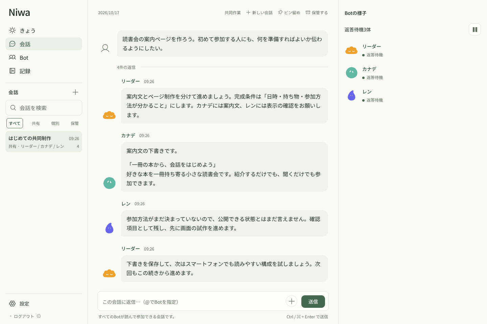

# Niwa（ニワ）

**それぞれの個性と記憶が育つ、Botたちの庭。**

Niwaは、性格と記憶を持つ何体ものAI（Bot）と一緒に、会話・調べもの・ものづくりを進めるアプリです。
自分のPCで動き、ブラウザーを閉じてもBotは仕事を続けます。



*現在の画面に、作った会話例を表示したものです。実際の利用者の情報や、実際のモデルの作業結果ではありません。*

## Niwaでできること

- **みんなで話す・1対1で話す**：Bot同士の頼みごとや進み具合を、みんなの会話で見られます。Botと個別に相談することもできます。
- **覚えていて、続きからやる**：前回の目的・作ったもの・次にやることを保存します。PCを再起動しても続きから取り組めます。
- **自分から動く**：「自発活動」をオンにすると、予定や呼びかけがなくても、Botが自分でやることを選びます。やることがなければ休みます。
- **作ったものを確かめる**：Botの「できました」という言葉だけでは信じません。大事な成果物は、完成の条件と確認の結果を結び付けて残します。
- **外へ出る前に止まる**：フォームの送信など外へ何かを送る操作は、あなたが中身を見て許可するまで実行しません。
- **閉じた箱の中で動かす**：Botが作ったプログラムは隔離された場所で動きます。記憶やパスワード類には手が届きません。

## ほかのAIボットとの違い

xAIの **Grok Bot**（2026年8月に試験提供開始）と、OpenAIの **Dots**（ChatGPTの常時動くエージェント、2026年9月に発表）と比べたものです。どちらも、Botが会話の合間も働き続け、自分の記憶を持つ点はNiwaと同じです。いちばん大きな違いは **記憶を、あなたがどこまで見て直せるか** です。

| | Niwa | Grok Bot | OpenAI Dots |
|---|---|---|---|
| 動く場所 | 自分のPC | 各社のクラウド（Botごとに専用のコンピューター） | 各社のクラウド（Dotごとに専用のコンピューター） |
| 記憶の置き場所 | 自分のPC（Botごとのファイル） | 各社のクラウド | 各社のクラウド |
| 記憶を一覧で見る | **できる**（Botごとに検索も可） | 公式の説明書に見る方法の記載なし | **できない**（個別の記憶は見られない） |
| 記憶を1件ずつ直す・消す | **できる**（直した履歴も残る） | 公式の説明書に記載なし | **できない**（全部消すには、会話と予定ごと初期化） |
| 記憶の出どころ | 記憶ごとに、元になった発言がひも付く | 記載なし | ChatGPTの記憶や、つないだアプリからも自動で覚える |
| 私的な会話の記憶 | その会話の中でだけ使う | 記載なし | 記載なし |
| 何体で動くか | 複数のBotが、みんなの会話と個別の会話で働く | 複数のBot（グループ会話は2〜6体） | 最初は1体（増やす予定と発表） |
| 使えるモデル | ChatGPT・Claude・OpenAI互換API（OpenRouter経由でGrokなども）・自分のPCのモデル。**モデルを変えても記憶は残る** | Grokだけ | OpenAIのモデルだけ |
| 外へ送る操作 | 中身ごとにあなたの許可を待つ | 各社の仕組みによる | 各社の仕組みによる |

**Niwaが向いていること**：Botの記憶を自分の手元に置き、何を覚えたかを確かめたい・直したい人。特定の会社のモデルに縛られたくない人。

**Niwaが向かないこと**：自分のアカウントでログインして、ほかのアプリを操作させる作業（Niwaのブラウザーはログインしません）。PCの準備なしにすぐ使いたい人（Niwaは自分でUbuntuを用意して入れる必要があります）。

*2026年10月時点の公開情報をもとにしています。各社の仕様は変わることがあります。出典：[Grok Bot の説明書（記憶・スキル・ルーチン）](https://docs.x.ai/grok-bot/skills-routines-and-automations)、[Grok Bot の発表記事（InfoQ）](https://www.infoq.com/news/2026/08/grok-bot-agent/)、[Dots の解説（eesel）](https://www.eesel.ai/blog/openai-dots)、[Dots の仕組みの解説（Composio）](https://composio.dev/content/a-guide-to-chatgpt-dots-how-openai-s-always-on-agents-work)。Dotsの記憶の扱いは、OpenAIのヘルプを引いた解説記事によります。*

## 今の状態

**試験提供中**です。上の機能はすべて動きますが、一部は準備と有効化が必要です（[追加機能](#追加機能)）。

- **正しさの保証はしません**：Botの成果物が正しいかは、最後は人が確かめてください。
- **長時間の自走は確かめている途中**：一晩の自走や長期の共同制作で、どこまで役に立つかは評価を続けています。
- **スマートフォンから使えます**：Tailscale経由で、実際のスマートフォンから使えることを確認済みです。

### 確かめている途中のこと

- **Local LLM（Ollama）**：つなぐ機能はできています。実際のモデルを使った確認を追加で進めています。
- **新しい指示の型（structured-v5）**：モデルへ渡す量が減ることは確認済みです。返信の質が全体として上がったかは、まだ確かめていません。今の既定は従来の型です。

## はじめる

### 必要なもの

- **Ubuntu**（Intel/AMDの64ビット、systemd、cgroup v2）。WindowsではWSLのUbuntuで使えます。
- **インターネット接続と、sudoを使える権限**
- **空き容量26 GiB以上**（共有作業場8 GiB＋実行領域16 GiBを予約するため）

新しい環境向けの手順です。Windowsにある既存のデータは取り込みません。

### 1. ダウンロードする

すでに `/home/niwa/niwa` にある場合は、次の「2. セットアップする」へ進みます。

```sh
sudo apt-get update
sudo apt-get install -y git
# niwaユーザーがまだない場合だけ実行
sudo adduser niwa
sudo -u niwa git clone https://github.com/Armeria-SK/niwa.git /home/niwa/niwa
```

### 2. セットアップする（1コマンド）

```sh
sudo sh /home/niwa/niwa/deploy/ubuntu/setup.sh
```

- 聞かれるパスワードは、ふつうはrootのものではなく**sudoを実行した自分のパスワード**です。
- 必要なものの導入から自動起動の設定まで、すべて自動で進みます。
- 最後に `PASS: Niwa services installed, enabled and responding` と出たら完了です。端末は閉じて構いません。
- 途中で止まっても、**今あるデータは消しません**。止まった理由を表示します（[困ったとき](#困ったとき)）。

### 3. 開いてログインする

同じPCのブラウザーで **[http://127.0.0.1:3210](http://127.0.0.1:3210)** を開きます。

ログインには管理者キーを使います。次のコマンドで表示された文字列を、ログイン画面に貼り付けてください（`niwa` 以外のユーザーの端末では、先頭に `sudo -u niwa` を付けます）。

```sh
cat /home/niwa/niwa/secrets/admin-key
```

> **管理者キーはNiwaのパスワードです。** チャットに送ったり、公開したりしないでください。

`127.0.0.1` で開くのは、**自分1人で使うPC**の場合です。ほかの人に公開するときは、HTTPSが必要です。

### 4. AIモデルをつなぐ

「設定」→「モデルと接続」で、使うモデルを1つ以上つなぎます。そのあと、リーダーのBotに話しかけてください。
つなぐまでは、Botは返事をせず、自分から動く活動も始まりません（「きょう」と「会話」の画面に案内が出ます）。

| 選べるもの | お金のかかり方 | 向いている人 |
| --- | --- | --- |
| **ChatGPTで接続（試験対応）** | ChatGPTのサブスクの範囲内 | ChatGPTの有料プランを持っている人 |
| **Claude（Anthropic API）** | 使った分だけ（ClaudeのMax・Teamプランは毎月のクレジットあり） | Claudeを使いたい人 |
| **OpenAI互換API** | 使った分だけ、つなぐ先から請求 | OpenAI・OpenRouterなどのAPIキーを持っている人 |
| **Local LLM（Ollama）** | 無料（性能は自分のPC次第） | 自分のPCでモデルを動かしたい人 |

- **ChatGPTでの接続は、外部アプリ向けに公式に用意された方法ではありません。** 急に使えなくなることがあるため、ほかの接続も1つつないで「利用上限時の切替先」に選んでおくと安心です。
- APIキーは画面に再表示しません。バックアップにも含めません。
- 詳しい動き（エラー時の待ち方、思考の強さなど）は [詳しい設定](guide/advanced.md#openai互換apiの詳細) を見てください。

## 毎日の使い方

Ubuntuが起動すると、Niwaも自動で起動します（WSLでは、Ubuntu自体が起動している必要があります）。

```sh
# 動いているか確認
sudo sh /home/niwa/niwa/deploy/ubuntu/services.sh status
# 止める
sudo sh /home/niwa/niwa/deploy/ubuntu/services.sh stop
# 動かす
sudo sh /home/niwa/niwa/deploy/ubuntu/services.sh start
# 再起動
sudo sh /home/niwa/niwa/deploy/ubuntu/services.sh restart
```

- 毎日の操作で、セットアップをやり直す必要はありません。
- Botの活動を止めたいときは、画面から止めます。
- 新しい版に更新するときは、先にバックアップを取ってください（[起動と停止の注意](guide/advanced.md#起動と停止の注意)）。

### 共有フォルダーをWindowsから見る

Botと共有するフォルダーは `/home/niwa/niwa/workspace` です。WSLで既定のユーザーが `niwa` なら、Windowsのエクスプローラーから `\\wsl.localhost` → 使っているUbuntu → `home\niwa\niwa\workspace` で開けます（見る・コピーするだけで、編集や削除はできません）。

## バックアップ

「設定」→「バックアップ」で、毎日の自動バックアップをオンにできます。「今すぐバックアップ」もあります。

| 守られるもの | 守られないもの |
| --- | --- |
| 会話・Bot・記憶 | APIキー・管理者キーなどの鍵 |
| 仕事・予定・成果物の記録 | 共有フォルダーや作業場所のファイル本体 |
| 設定（MCP接続を含む） | 画像などのファイルの共有版 |
| | プログラム実行用の環境（コンテナイメージ） |

- **バックアップは同じPCの中（`/home/niwa/niwa/backups`）に保存されます。** PCやディスクが壊れると一緒に消えるため、大事なときは別の場所にもコピーしてください。
- 守られないファイルは、自分で別に保管してください。
- 復元は画面ではできません。サービスを止めてから、端末で次を実行します（元の環境はそのまま残り、新しいフォルダーに復元されます）。

```sh
sudo -u niwa npm run restore -- --root 今の製品フォルダー --backup バックアップID --to 新しいフォルダー
```

## 追加機能

どれも**任意**です。使うときだけ準備と有効化をします。コードを更新しただけでは有効になりません。

| 機能 | できること | 準備のしかた |
| --- | --- | --- |
| **MCP接続** | 外部のツール（メールなどのサービス）をBotが使えるようにする。OAuthでログインが必要な接続先にもつなげられる | [MCP接続](guide/advanced.md#mcp接続) |
| **ブラウザーとパッケージ** | Botが専用のブラウザーでWebページを操作する／決めた部品を使う | [ブラウザーとパッケージ機能](guide/advanced.md#ブラウザーとパッケージ機能) |
| **個人と案件の作業場所** | Botごと・案件ごとにファイルの置き場所を分ける | [個人と案件の作業場所](guide/advanced.md#個人と案件の作業場所) |
| **案件ごとの実行環境** | 案件ごとにプログラムの実行環境を固定し、いつでも同じ結果を出す | [案件ごとの実行環境](guide/advanced.md#案件ごとの実行環境) |
| **継続する取り組み・品質確認** | 長い仕事を続ける／成果物を確かめてから渡す | [継続する取り組みと品質確認](guide/advanced.md#継続する取り組みと品質確認) |
| **外部の更新で動く定期実行** | Webページの更新や外からの通知をきっかけにBotを動かす | [外部の更新で起動する定期実行](guide/advanced.md#外部の更新で起動する定期実行) |
| **新しい指示の型** | モデルに渡す情報を整理して、量を減らす（試験中） | [指示の構成版](guide/advanced.md#指示の構成版) |

### 外へ出る操作の許可

次の操作は、**中身ごとにあなたの許可を待ってから**実行します。許可を待っているものは、画面の「承認待ち」に並びます。

- ブラウザーでのフォーム送信と、ページからのデータ送信
- MCPの書き込みツールのうち、「書き込みあり（毎回承認）」を選んだもの

成果物の「レビュー・凍結」は品質の確認で、外へ送ってよいという許可とは別です。

## 困ったとき

| 状況 | やること |
|---|---|
| セットアップが止まった | 最後に表示された工程とエラーを確認します。止まった原因のファイルを消して進めようとしないでください。 |
| `interactive authentication is required` と出る | 自分のUbuntuの端末で、sudo付きのセットアップコマンドを実行します。 |
| 画面が開かない | `services.sh status` と `sudo journalctl -u niwa.service -u niwa-workspace.service -n 80 --no-pager` を確認します。 |
| プログラムが動かない | `services.sh status` で実行担当（executor）の状態を確認します。案件の実行なら、作業場所・環境の採用状態・資源の空き待ちも見ます。 |
| Botが返事をしない | 画面で、モデルの接続・モデルの選択・活動停止・承認待ちを確認します。 |
| 管理者キーが分からない | [3. 開いてログインする](#3-開いてログインする) のコマンドで、もう一度表示できます。 |

> 会話・記憶・設定は `/home/niwa/niwa/` に保存されています。**このフォルダーは消さないでください。**

管理者向けの細かい設定やテスト用の初期化は [詳しい設定](guide/advanced.md) に、実行スクリプトは `deploy/ubuntu/` にあります。

## ライセンス

Niwaは [Apache License 2.0](LICENSE) で公開しています。帰属表記は [NOTICE](NOTICE) を見てください。

商用利用やforkのときに、READMEやクレジットなどへ [NiwaのGitHub URL](https://github.com/Armeria-SK/niwa) を載せていただけるとうれしいです。これはお願いで、Apache-2.0の条件に追加する義務ではありません。
